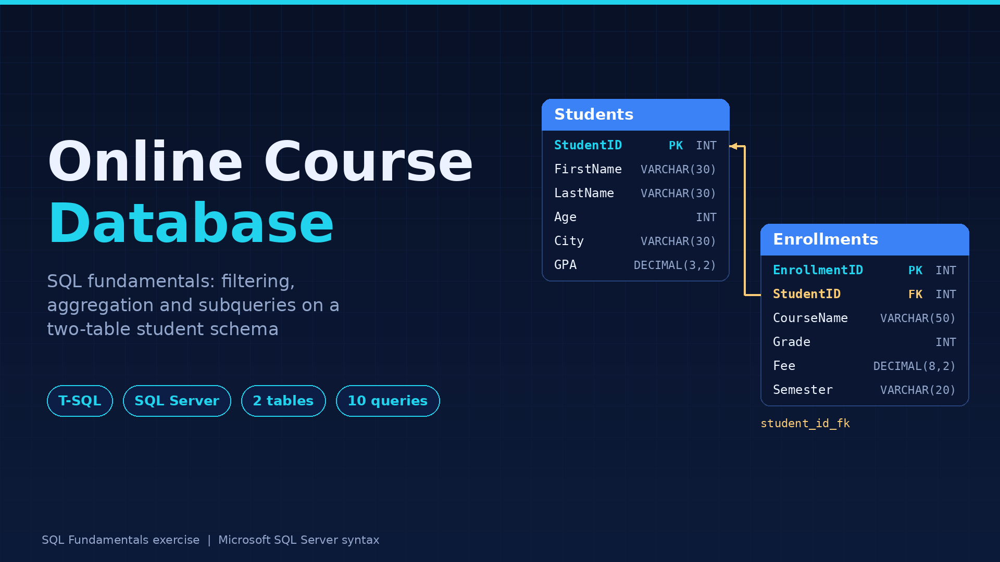
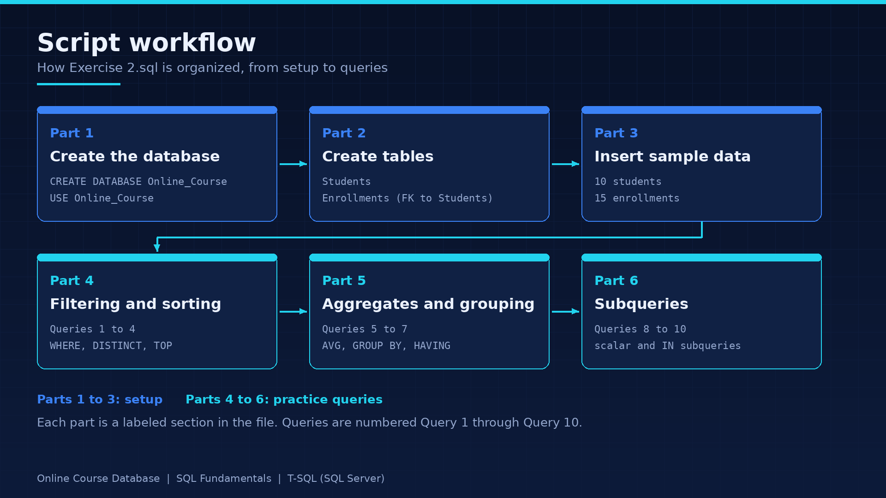
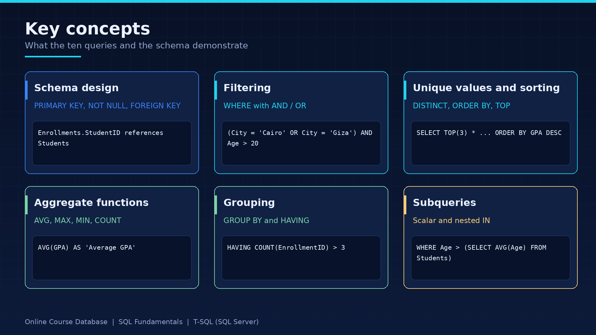
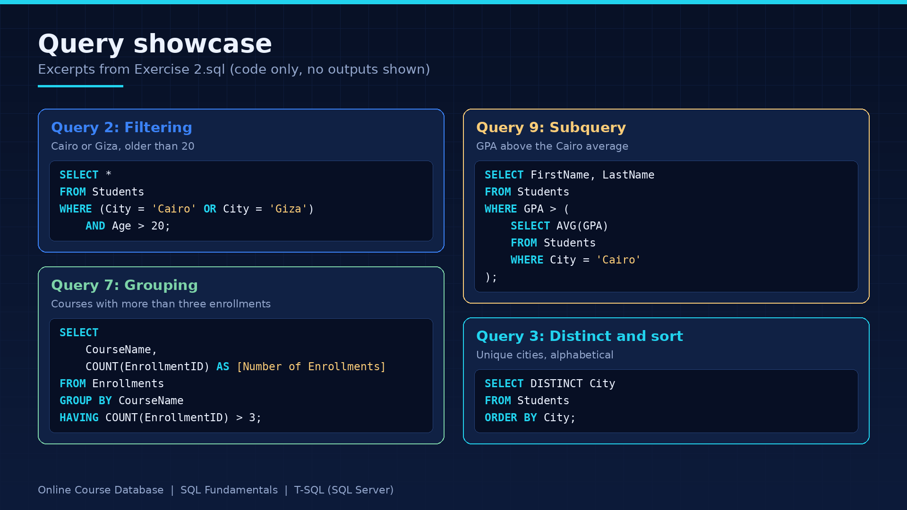

# Online Course System — SQL Server Project

A beginner-friendly SQL Server project that builds a simple online course database, inserts sample student and enrollment records, and uses SQL queries to explore student performance and course enrollment data.

## Project Overview

This project demonstrates how to create and query a relational database using **Microsoft SQL Server and T-SQL**. It models students and their course enrollments, including student information, course names, grades, fees, and semesters.

The exercise covers database creation, table relationships, sample data insertion, filtering, sorting, aggregate calculations, grouping, and subqueries.

## Database Structure

The database is named `Online_Course` and contains two related tables.

| Table | Description |
|---|---|
| `Students` | Stores student information, including names, age, city, and GPA. |
| `Enrollments` | Stores course enrollment records, including student ID, course name, grade, fee, and semester. |

### Students Table

| Column | Data Type | Description |
|---|---|---|
| `StudentID` | `INT` | Primary key identifying each student |
| `FirstName` | `VARCHAR(30)` | Student's first name; required |
| `LastName` | `VARCHAR(30)` | Student's last name; required |
| `Age` | `INT` | Student's age |
| `City` | `VARCHAR(30)` | Student's city |
| `GPA` | `DECIMAL(3,2)` | Student's grade point average |

### Enrollments Table

| Column | Data Type | Description |
|---|---|---|
| `EnrollmentID` | `INT` | Primary key identifying each enrollment |
| `StudentID` | `INT` | Foreign key referencing `Students.StudentID` |
| `CourseName` | `VARCHAR(50)` | Course name; required |
| `Grade` | `INT` | Grade earned in the course |
| `Fee` | `DECIMAL(8,2)` | Course fee |
| `Semester` | `VARCHAR(20)` | Semester associated with the enrollment |

### Database Relationship

The `StudentID` column in `Enrollments` references the `StudentID` primary key in `Students`, connecting enrollment records to the students they belong to.



## Project Contents

The project includes SQL statements for:

- Creating the `Online_Course` database.
- Creating the `Students` and `Enrollments` tables.
- Defining primary and foreign key constraints.
- Inserting sample student and enrollment data.
- Retrieving student records using filtering conditions.
- Analyzing student GPAs and course grades.
- Grouping enrollment records and filtering aggregated results.
- Using subqueries to compare individual values with calculated averages.

## SQL Concepts Demonstrated

### 1. Database and Table Creation
- `CREATE DATABASE`
- `USE`
- `CREATE TABLE`
- Primary keys and foreign keys
- Data types and `NOT NULL` constraints
- `GO` batch separators

### 2. Filtering and Sorting
- `WHERE`
- Comparison operators
- `AND` and `OR`
- `DISTINCT`
- `ORDER BY`
- `TOP`

### 3. Aggregate Functions
- `AVG()`
- `MAX()`
- `MIN()`
- `COUNT()`

### 4. Grouping and Aggregate Filtering
- `GROUP BY`
- `HAVING`

### 5. Subqueries
- Scalar subqueries with aggregate functions
- Filtering records using calculated averages
- `IN` with a subquery



## Example Queries

### 1. Retrieve Students with a GPA Greater Than 3.00

```sql
SELECT FirstName, LastName, Age, GPA
FROM Students
WHERE GPA > 3.00;
```

### 2. Find the Average, Highest, and Lowest GPA

```sql
SELECT
    AVG(GPA) AS [Average GPA],
    MAX(GPA) AS [Highest GPA],
    MIN(GPA) AS [Lowest GPA]
FROM Students;
```

### 3. Calculate the Average Grade for Each Course

```sql
SELECT
    CourseName,
    AVG(Grade) AS AverageGrade
FROM Enrollments
GROUP BY CourseName;
```

### 4. Find Courses with More Than Three Enrollments

```sql
SELECT
    CourseName,
    COUNT(EnrollmentID) AS [Number of Enrollments]
FROM Enrollments
GROUP BY CourseName
HAVING COUNT(EnrollmentID) > 3;
```

### 5. Find Students Older Than the Average Student Age

```sql
SELECT FirstName, LastName
FROM Students
WHERE Age > (
    SELECT AVG(Age)
    FROM Students
);
```

### 6. Find Students Whose Enrollment Grade Exceeds the Overall Average

This query uses a subquery without a `JOIN`, as required by the exercise.

```sql
SELECT FirstName, LastName, GPA
FROM Students
WHERE StudentID IN (
    SELECT StudentID
    FROM Enrollments
    WHERE Grade > (
        SELECT AVG(Grade)
        FROM Enrollments
    )
);
```

The project also includes queries for students living in Cairo or Giza who are older than 20, the top three students by GPA, distinct cities in alphabetical order, and students whose GPA exceeds the average GPA of students living in Cairo.



## How to Run the Project

### Requirements

- Microsoft SQL Server
- SQL Server Management Studio (SSMS), or another compatible SQL Server client

### Steps

1. Clone or download this repository.
2. Open the SQL script in your SQL Server client.
3. Review the script before executing it.
4. Execute the database creation and table setup statements.
5. Insert the sample data.
6. Run the queries to explore the results.

**Note:** The script uses SQL Server-specific syntax, including `GO` and `TOP`. It is intended for Microsoft SQL Server and may require modifications to run on other database systems.

If the database or tables already exist, review the creation statements before rerunning the script to avoid object-exists or duplicate-data errors.

## Repository Structure

```text
online-course-system-sql/
├── images/
│   ├── exercise-2-banner.png
│   ├── exercise-2-workflow.png
│   ├── exercise-2-concepts.png
│   └── exercise-2-showcase.png
├── Exercise 2.sql
└── README.md
```

The filenames shown above should match the files uploaded to GitHub. If the SQL script has a different filename in the repository, update the structure accordingly.

## Learning Outcomes

Through this exercise, I practiced:

- Designing a relational database with related tables.
- Defining primary and foreign key relationships.
- Writing SQL queries to retrieve and filter records.
- Applying aggregate functions to student and course data.
- Grouping records and filtering grouped results.
- Using subqueries to answer data-analysis questions.

## Technologies

- **Database:** Microsoft SQL Server
- **Query Language:** T-SQL
- **Tools:** SQL Server Management Studio (SSMS) or a compatible SQL Server client

---

*This project is part of my ongoing practice in SQL, relational database design, and data querying.*
